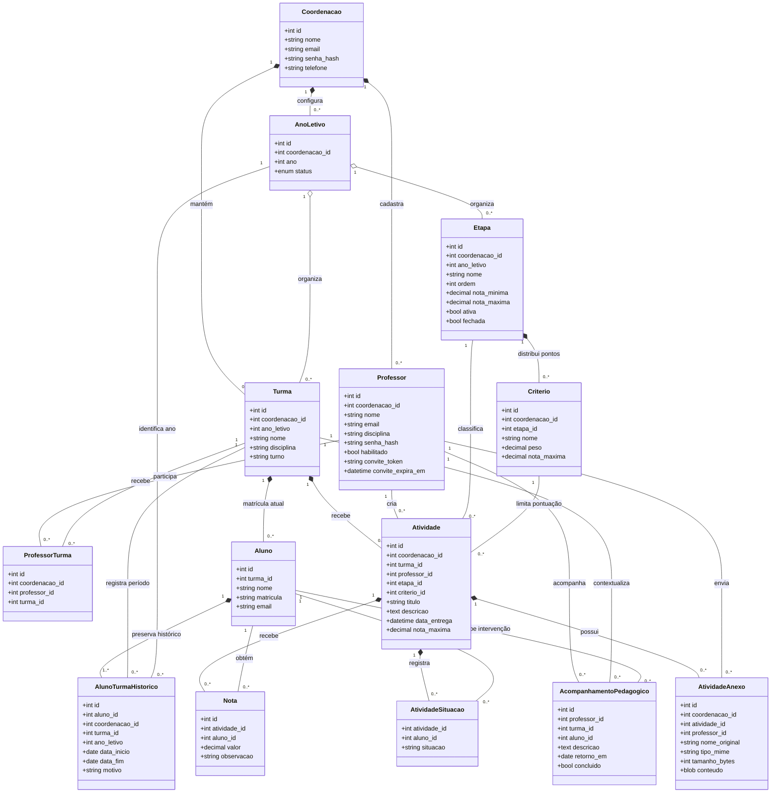
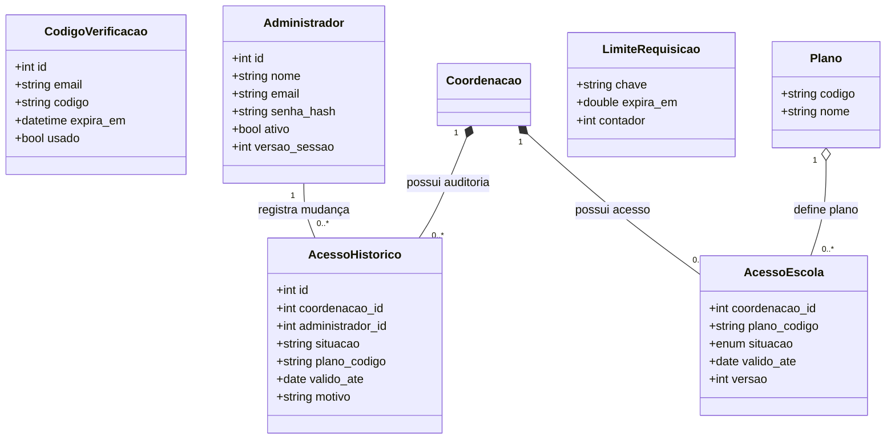

# Diagrama de classes e entidades do Mentorly

Este desenho foi conferido com as Models em `backend/models/` e com as tabelas dos três arquivos de instalação: `schema.sql`, `professor_workspace.sql` e `comercial.sql`. Ele representa o que o sistema realmente persiste hoje, inclusive anexos, situações de entrega, acompanhamento pedagógico e controle administrativo.

`ProfessorTurma` resolve a relação muitos-para-muitos entre professores e turmas. `Nota` e `AtividadeSituacao` são diferentes de propósito: a primeira guarda um valor numérico; a segunda guarda “Ausente”, “Não entregou” ou “Não corrigido”, sem transformar pendência em nota zero. `AtividadeAnexo` guarda o arquivo no banco, ligado à atividade, para que ele entre no backup e não fique exposto em uma pasta pública.

## Autenticação, administração e infraestrutura

`CodigoVerificacao` fica ligado ao e-mail, sem chave estrangeira, porque é criado antes da conta existir. `LimiteRequisicao` é uma entidade de infraestrutura usada para impedir abuso em login, códigos, convites e IA; ela não se relaciona ao domínio escolar. `ConfiguracaoAno`, em `backend/models/configuracao_ano_model.py`, não é tabela nem entidade: é uma fachada de persistência transacional que atualiza etapas e critérios juntos.

As entidades CRUD herdam de `db.Model`, mas o projeto usa SQL parametrizado nos métodos das Models e dos Repositories. `AtividadeSituacao` e `AcompanhamentoPedagogico` são tabelas ativas acessadas pelo service de trabalho do professor e ainda não têm uma classe ORM própria; por isso aparecem no diagrama como entidades persistidas, e não como classes Python.
