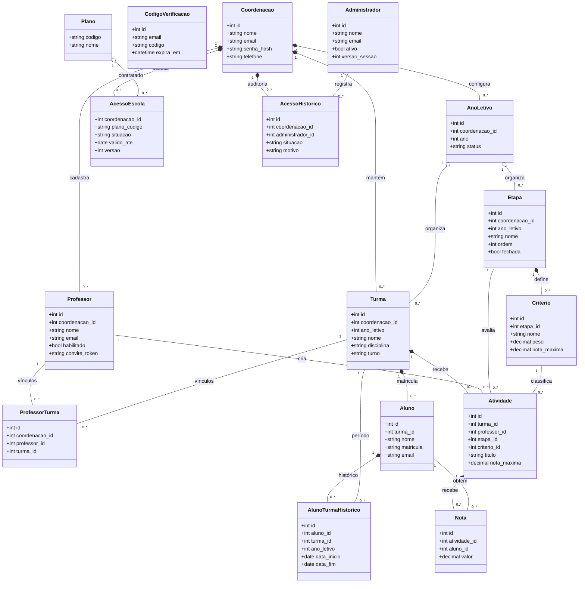

# Diagrama de classes do domínio

As classes abaixo estão em `backend/models/` e herdam de `db.Model`. Os atributos correspondem às colunas mapeadas no MySQL. As multiplicidades representam os vínculos do domínio; o isolamento entre escolas também é garantido pelas chaves estrangeiras compostas em `backend/database/schema.sql`.

`ProfessorTurma` representa a relação muitos-para-muitos entre professores e turmas. `CodigoVerificacao` é usado no fluxo de autenticação e não possui chave estrangeira. Não há herança entre entidades do domínio; todas herdam da infraestrutura `db.Model`. Os campos de data, descrição e configuração adicionais aparecem nas Models e no schema SQL, mas foram omitidos do desenho para manter a leitura.
